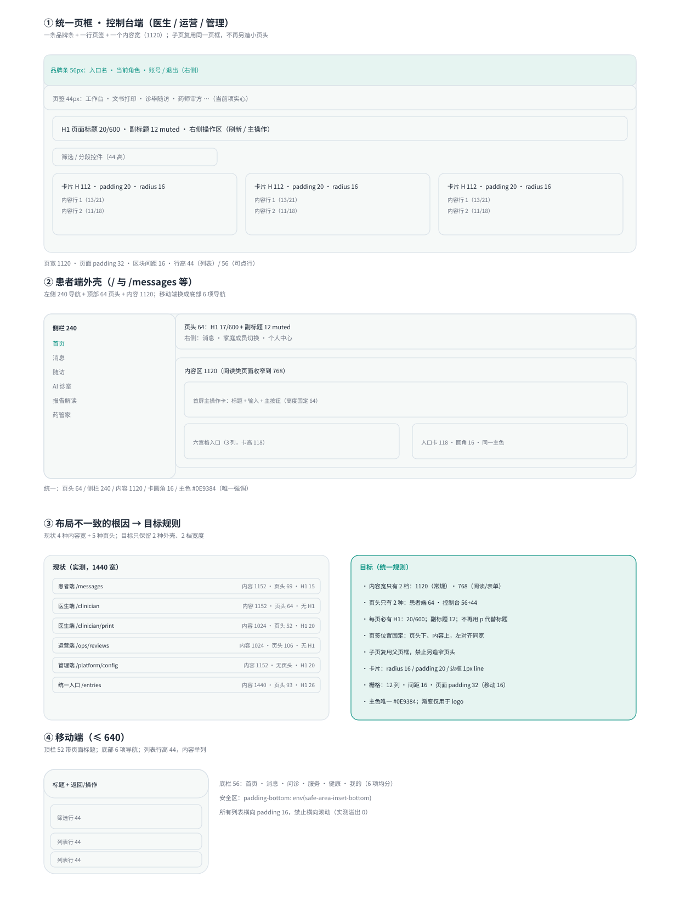

# V3.4 布局一致性规范（四端统一页框）

> 日期：2026-11-11
> 结论：四端目前是**四套内容宽 + 五种页头 + 三种导航位置**，同一产品里看起来像四个不同产品拼起来。
> 本规范只做一件事：**把 61 屏收敛成 2 种外壳、2 档宽度、1 套页头规则**，不改信息架构。



---

## 1. 现状实测（1440 宽，真实生产页面）

| 页面 | 页头高 | 内容宽 / 左边距 | H1 字号 | 导航位置 | 问题 |
|---|---:|---|---:|---|---|
| 患者端 `/`、`/messages` | 69px | 1152 / 272 | 15px | 左侧栏 + 页头 | 宽且标题偏小 |
| 医生端 `/clinician` | 64px | 1152 / 144 | **无 H1** | 页头下方 | 标题用 `<p>` 代替 |
| `/clinician/print` | 52px | 1024 / 208 | 20px | 内容区顶部 | 页头矮一档 |
| 运营端 `/ops` | 64px | 1024 / 208 | **无 H1** | 页头下方 | — |
| `/ops/reviews` | **106px** | 1024 / 208 | 无 H1 | 页头里 | 双层页头（品牌条 + 子页头） |
| 管理端 `/platform` | 64px | 1024 / 208 | 无 H1 | 页头下方 | — |
| `/platform/config` | **无页头** | 1152 / 144 | 20px | 内容区顶部 | 缺页头，靠导航找位置 |
| `/platform/knowledge` | 52px | 1152 / 144 | 20px | 内容区顶部 | 又一种页头 |
| 统一入口 `/entries` | 93px | 1440 / 0 | 26px | — | 全出血，与其它页不同 |

**四类差异**

1. **内容宽**：1024 / 1152 / 1440 三种，外加若干 768 的窄页 → 卡片密度、折行位置全都不一样；
2. **页头高**：52 / 64 / 69 / 93 / 106 五种，还有一页没有页头；
3. **标题**：20px / 15px / 26px 三种，三个根页面干脆没有 `h1`；
4. **导航位置**：左侧栏、页头下方、页头里、内容区顶部四种 → 用户每次换端都要重新找导航。

---

## 2. 目标：2 种外壳 + 2 档宽度

### 2.1 外壳 A · 患者端（`AppShell`）

| 要素 | 规格 |
|---|---|
| 侧栏 | 240px，固定，选中项实心主色 |
| 页头 | 64px 吸顶：H1 17/600 + 副标题 12 muted；右侧为消息、成员切换、个人中心 |
| 内容 | max 1120，页面 padding 32（移动 16） |
| 阅读类页 | 消息 / 随访 / 表单收窄到 **768** |
| 移动端 | 顶栏 52（含页面标题）+ 底部 6 项导航（首页 · 消息 · 问诊 · 服务 · 健康 · 我的） |

### 2.2 外壳 B · 控制台端（医生 / 运营 / 管理，`ConsoleShell`）

| 要素 | 规格 |
|---|---|
| 品牌条 | 56px：入口名 · 角色 · 账号 / 退出 |
| 页签 | 44px，紧贴品牌条下方，左对齐与内容同宽，当前项实心 |
| 页头行 | 44px：H1 20/600 + 副标题 12 + 右侧操作（刷新 / 主操作） |
| 内容 | max 1120；列表行 44，可点行 56 |
| 子页 | **不另造页头**：沿用父页框，只切换页签选中项 |

### 2.3 全局 token

| 项 | 值 |
|---|---|
| 主色 | `#0E9384`（唯一强调；渐变只用于 logo） |
| 中性地板 | 背景 `#F6F9F8` / 卡 `#FFFFFF` / 线 `#D9E1E8` |
| 圆角 | 卡片 16、输入 12、chip 999 |
| 间距 | 4 的倍数：区块 16，卡片内 20，页面 32 |
| 字号 | H1 20（控制台）/ 17（患者端页头）· 区块标题 15 · 正文 13 · 辅助 11 |
| 行高 | 列表 44 · 可点行 56 · 表单 44 |

---

## 3. 页面映射（61 屏 → 2 种外壳）

| 端 | 外壳 | 需要做的改造 |
|---|---|---|
| 患者端 16 屏 | A | 内容宽统一 1120；消息 / 随访 / 表单收 768；补齐移动标题（已完成） |
| 医生端 12 屏 | B | `/clinician` 与三个子页统一成同一页框；子页去掉独立小页头；补 H1 |
| 运营端 8 屏 | B | `/ops/reviews` 等子页合并双层页头；补 H1 |
| 管理端 25 屏 | B | `/platform/config`、`/knowledge` 等补页头与 H1；统一 1120 |
| 统一入口 | 独立单页 | 允许全出血，但标题字号纳入 token（26 → 24） |

---

## 4. 实施顺序与验收

| 步骤 | 内容 | 验收 |
|---|---|---|
| 1 | 抽 `ConsoleShell` 组件（品牌条 + 页签 + 页头行 + 内容容器） | 医生 / 运营 / 管理各迁 1 页，页头高度读数一致 |
| 2 | 患者端 `AppShell` 接入统一 token（宽度、页头、卡片） | 消息 / 随访收窄到 768 |
| 3 | 子页去双层页头，逐个补 H1 | 每页 `document.querySelectorAll("h1").length === 1` |
| 4 | 视觉回归脚本（已有 `frontend/scripts/layout-audit.mjs`） | 四端页头 / 宽度 / 标题字号读数一致 |

复核命令：

```bash
cd frontend && node scripts/layout-audit.mjs   # 打印每页页头高/内容宽/H1/导航位置
npx tsc --noEmit && npx playwright test        # 类型 + 26 条 E2E
```

> 说明：本规范只统一页框与密度，不新增功能；现有 61 屏的接口、权限与六态逻辑不变。

---

## 5. 落地结果（2026-11-12）

已按方案 A 全量接入三栏页框（对齐演示站 \`prototype/dual-end.html\`）：

| 项 | 落地 |
|---|---|
| 页框 | \`AppFrame\`：顶栏 64 + 左栏 208 + 主区 1fr + 右栏 328 Agent 面板 |
| 端切换 | 顶栏 scope 徽标显示当前端；四端共用同一页框 |
| 左栏 | 分组导航（常用/就医/我的 · 诊疗/协同 · 监控/治理 · 概览/接入/建设），选中项实心 |
| 页头 | 统一 21/12.5，每页恰好一个 H1 |
| 右栏 | 真实数据：能力矩阵 + \`model_calls\` 近 7 天调用与延迟 + 边界说明；按当前端切换（\`/api/v1/agent/panel?end=\`） |
| 患者端 | 16 屏全部继承新页框；移动端新增底部 6 项导航 |
| 控制台 | 医生 7 页 / 运营 7 页 / 管理 6 页全部改为 \`ConsoleShell\`，旧页头与旧导航已移除 |

### 5.1 演示站自身的问题，一并修掉

| 演示站的问题 | 我们的处理 |
|---|---|
| 只按 1440 桌面设计，窄屏会挤坏 | <1024 左栏变抽屉、<1280 右栏变抽屉，390 宽实测横向溢出 0 |
| 右栏是假数据（写死的调用耗时） | 接 \`model_calls\` 真实数据；无调用时显示空态 |
| 右栏输入框只是装饰 | 改为「进入对话」真实跳转 |
| 无 URL，靠 JS 切屏，不能分享/刷新 | 保留真实路由，每个页面可直接访问 |
| 无权限态、无空态/错误态 | 保留六态组件（加载/空/错误/无权限/离线/只读） |
| 顶栏 scope 是假域名 | 换成本端 + 角色（scope）标识 |
| 无键盘与读屏支持 | 增加 skip link、\`aria-current\`、Esc 关闭抽屉、焦点可见 |

### 5.2 验收读数（生产 1440）

| 页面 | 顶栏 | 左栏 | 主区 | 右栏 | H1 |
|---|---:|---:|---:|---:|---:|
| 患者端 / | 64 | 208 | 904 | 328 | 21px |
| 医生端 /clinician/ | 64 | 208 | 904 | 328 | 21px |
| 运营端 /ops/ | 64 | 208 | 904 | 328 | 21px |
| 管理端 /platform/ | 64 | 208 | 904 | 328 | 21px |

> 复核：\`node frontend/scripts/layout-audit.mjs\` / \`node frontend/scripts/shell-check.mjs\` / \`node frontend/scripts/panel-check.mjs\`

